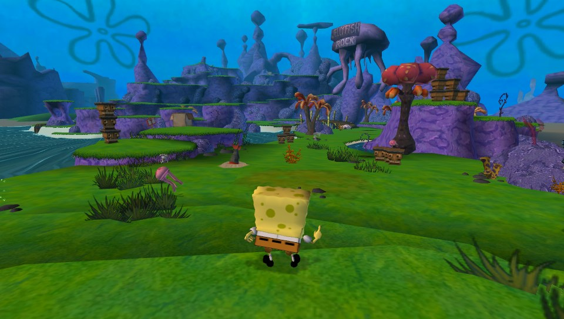

# Battle for Bikini Bottom Vita

</img> 

Port of Spongebob: Battle for Bikini Bottom for PSVita based off [the decompilation](https://github.com/zcanann/bfbb) of the Gamecube version.

## Features

- 960x544 internal resolution.
- Support for MSAA (up to 4x, defaults to Off).
- Optional 30 FPS lock (Defaults off).
- Widescreen support (Defaults to On).
- Ability to invert X and Y axis for camera.
- PS2 glyphs instead of Gamecube ones.
- Optional PostFX effects (CRT, CRT Bleeding, FXAA, Greyscale, LCD 3x, Negative, Sepia, Sharp Bilinear Grid, Sharp Bilinear Scanlines and Vignette).

## Special Controls

- Additional options menu accessible by touching the top-left portion of the screen.

## How to Install

- Install `libshacccg.suprx`, if you don't have it already, by following [this guide](https://samilops2.gitbook.io/vita-troubleshooting-guide/shader-compiler/extract-libshacccg.suprx).
- Install the vpk from the Release tab.
- Extract the `setup.zip` from the Release tab in a folder in your PC.
- Place the iso file of `Spongebob: Battle for Bikini Bottom (GQPE78 NTSC-U revision 0)` for Gamecube named as `bfbb.iso` in the same folder where you extracted the zip.
- If you don't have it already, install [Python 3.10 or higher](https://www.python.org/downloads/windows/).
- Open a command line in the same folder where you extracted the zip and run: `powershell.exe -NoProfile -ExecutionPolicy Bypass -File .\prepare_data.ps1 -Source "bfbb.iso" -FFmpeg "ffmpeg.exe"`
- Place the whole content of `DataForVita\bfbb` in `ux0:data/bfbb`.

## Changelog

### v.1.1

- Improved overall CPU usage (reduction of up to 20% of the workload, resulting in more stable framerate).
- Optimized the GPU workload of the Bubble Bounce move. Now it won't cause anymore a massive framedrop.
- Fixed a bug causing controls mapping scheme to change when a tutorial popup is on screen.
- Added optional PostFX effects (CRT, CRT Bleeding, FXAA, Greyscale, LCD 3x, Negative, Sepia, Sharp Bilinear Grid, Sharp Bilinear Scanlines and Vignette).
- Optimized the Mermalair monitors effect, now framerate will be more stable in the area.
- Fixed a bug causing Mermalair area to render in 4:3 even if widescreen was enabled.

## Credits

- Everyone involved in the [decompilation of the game](https://github.com/zcanann/bfbb)
- Darth Bellic for testing the game and for the Livearea assets.
